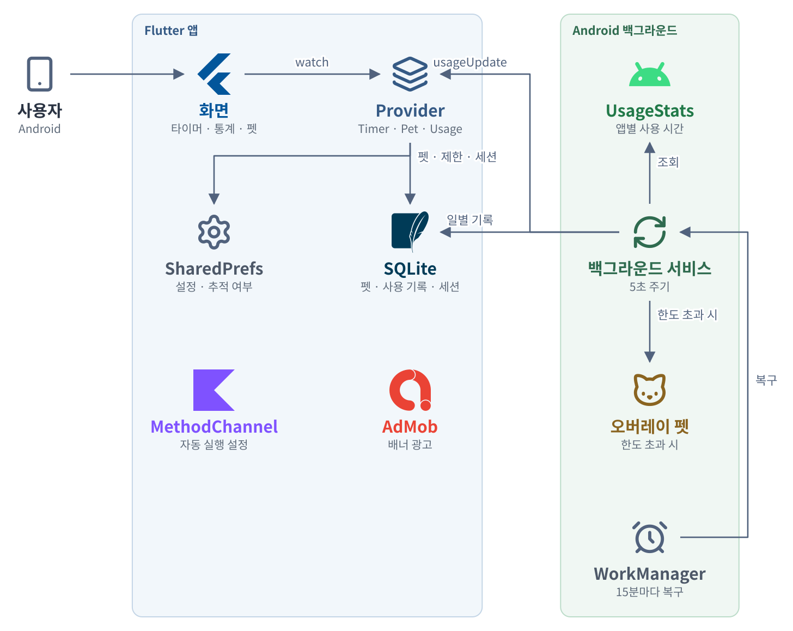
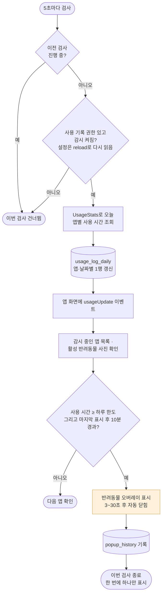
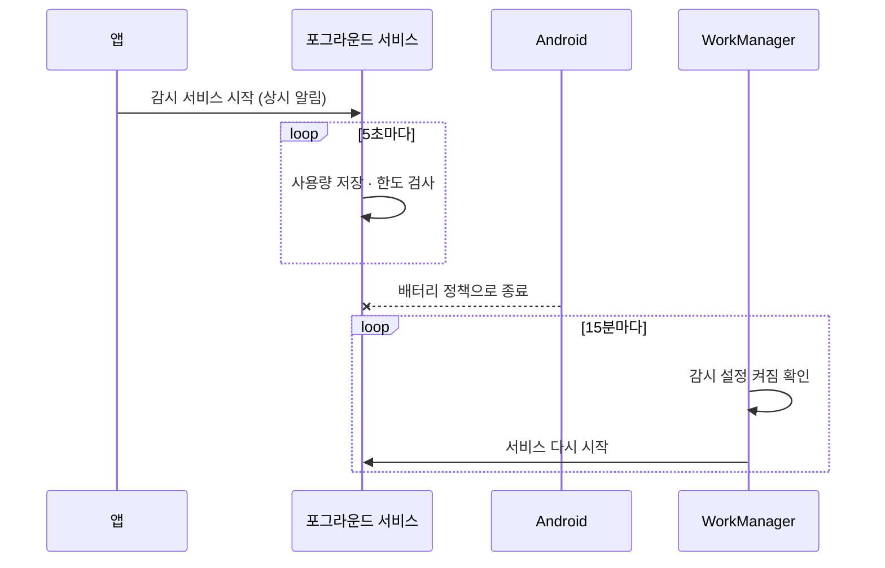
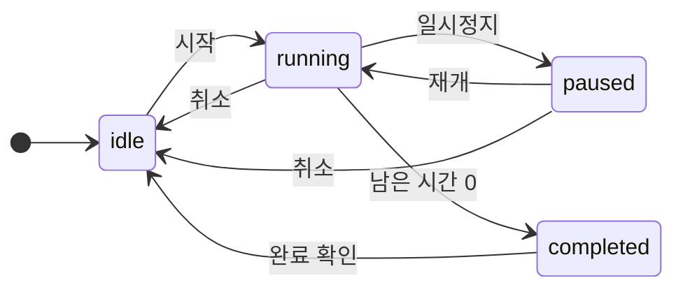
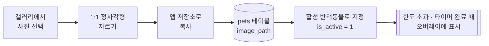
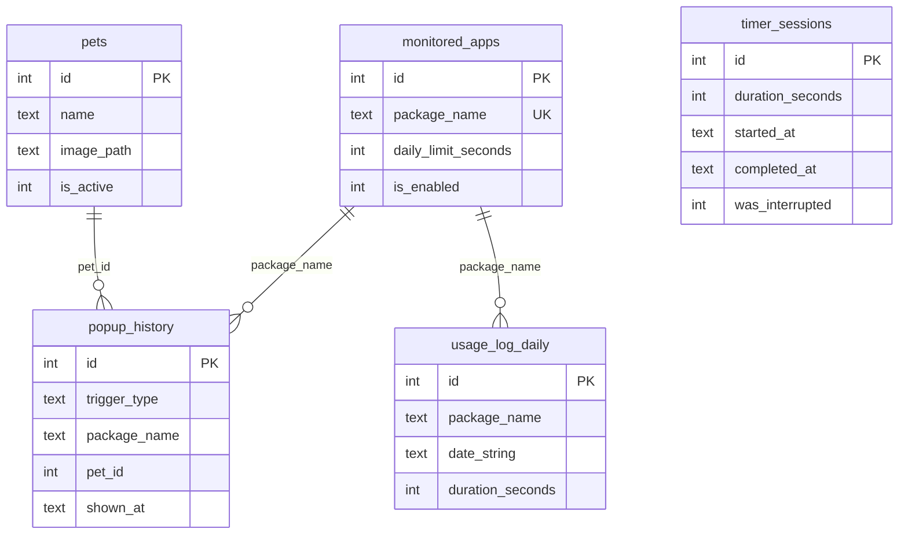

<div align="center">

# 여기봐용


</div>

내 반려동물 사진이 휴대폰 화면 위에 나타나 "그만 보고 여기 봐"라고 알려 주는 스크린 타임 관리 앱입니다. 다른 앱을 강제로 막는 대신, 사용자가 정한 앱의 하루 사용 시간이 한도를 넘으면 반려동물 캐릭터가 다른 앱 위에 잠깐 떠오릅니다. 반려동물과 함께하는 집중 타이머와 앱별 사용 통계도 제공합니다. Android 전용이며 한국어 · 영어를 지원합니다.

| 화면 | 기능 |
|------|------|
| 홈 | 오늘의 사용 시간 요약, 기기를 기울이면 움직이는 반려동물 |
| 타이머 | 집중 시간을 정해 반려동물과 함께 세션 진행, 기록 저장 |
| 통계 | 앱별 사용 시간의 일간 · 주간 막대 차트 |
| 반려동물 | 사진을 골라 잘라서 캐릭터 등록, 활성 반려동물 선택 |
| 앱 선택 · 설정 | 감시할 앱과 하루 한도, 오버레이 표시 시간, 권한 안내 |

## 전체 아키텍처

<p align="center">
  
</p>

| 흐름 | 설명 |
|------|------|
| 감시 | Background Service가 5초마다 UsageStats로 오늘의 앱별 사용 시간을 읽어 `usage_log_daily`에 기록 |
| 알림 | 감시 중인 앱이 `daily_limit_seconds`를 넘으면 활성 반려동물 오버레이를 띄우고 `popup_history`에 남김 (같은 앱은 10분 간격) |
| 화면 갱신 | Background Service가 `usageUpdate` 이벤트를 보내면 앱의 Provider가 통계를 갱신 |
| 복구 | 제조사 배터리 정책으로 서비스가 멈추는 경우를 대비해 WorkManager가 15분마다 서비스를 다시 시작 |

```text
lib/
├── screens/       홈 · 타이머 · 통계 · 반려동물 · 앱 선택 · 권한 안내 · 설정
├── providers/     app · timer · pet · usage · settings
├── services/      background · usage_tracking · overlay · notification · oem_settings
├── data/          SQLite 스키마, 모델, repository
├── overlay/       오버레이 창 진입점 (overlay_main.dart)
└── l10n/          한국어 · 영어 문구
android/.../MainActivity.kt   제조사 자동 실행 설정 화면을 여는 MethodChannel
```

## 기능 흐름

### 1. 사용 시간 감시와 반려동물 오버레이

백그라운드 서비스가 5초마다 아래 순서로 검사합니다. 활성 반려동물 사진이 없으면 오버레이를 띄우지 않고, 표시 시간은 설정값을 3~30초로 제한합니다.



### 2. 서비스가 꺼졌을 때 복구



### 3. 집중 타이머



| 전환 | 처리 |
|------|------|
| 시작 · 재개 | 종료 시각을 `지금 + 남은 초`로 다시 정하고 1초마다 남은 시간을 종료 시각에서 계산 |
| 일시정지 | 남은 초만 저장하고 종료 시각을 비움 |
| 남은 시간 0 | `timer_sessions`에 완료 세션 저장, 활성 반려동물 오버레이 표시 |
| 취소 | 중단(`was_interrupted = 1`)으로 세션 저장 |
| 앱이 백그라운드로 감 | 종료 시각에 완료 알림을 예약하고, 다시 앞으로 오면 예약을 취소 |

### 4. 반려동물 등록



### 5. 저장 구조 (SQLite)

다섯 테이블 사이에 외래 키 제약은 없고, `package_name`과 `pet_id` 값으로만 이어집니다.



## 핵심 설계 결정

| 결정 | 방식 | 위치 |
|------|------|------|
| 앱이 꺼져도 감시 | Android foreground service가 상시 알림을 띄운 채 5초마다 사용량을 조회 · 저장하고 한도를 검사합니다. 한 번의 검사에서는 오버레이를 하나만 띄우고, 검사가 겹치지 않도록 진행 중 표시를 둡니다. | `lib/services/background_service.dart` |
| 설정 변경을 재시작 없이 반영 | 백그라운드 isolate는 SharedPreferences 값을 캐시하므로 매 검사마다 `reload()`로 다시 읽습니다. 앱에서 바꾼 설정이 서비스 재시작 없이 적용됩니다. | `background_service.dart` |
| 알림 폭주 방지 | 같은 앱의 오버레이는 10분(`cooldownMinutes`) 간격으로만 띄우고, 띄운 기록은 `popup_history`에 남깁니다. | `background_service.dart` |
| 제조사 배터리 정책 대응 | WorkManager가 15분마다 서비스를 다시 시작하고, 삼성 · 샤오미 기기에서는 자동 실행 · 배터리 예외 설정 화면을 `MethodChannel`로 열어 사용자가 직접 풀 수 있게 안내합니다. | `lib/main.dart`, `android/.../MainActivity.kt` |
| 타이머 시간이 어긋나지 않게 | 종료 시각을 저장해 두고 1초마다 남은 시간을 다시 계산하므로 일시정지 · 재개 후에도 오차가 쌓이지 않습니다. | `lib/providers/` |
| 하루 한 행으로 사용 기록 관리 | `usage_log_daily`는 `(package_name, date_string)` 유니크 키로 하루 한 행씩 갱신합니다. | `lib/data/database/database_service.dart` |

## 필요 권한

앱 안의 권한 안내 화면이 시스템 설정으로 이동시킵니다.

| 권한 | 용도 |
|------|------|
| 사용 기록 접근 (`PACKAGE_USAGE_STATS`) | `UsageStatsManager`로 오늘 앱별 포그라운드 시간 조회 |
| 다른 앱 위에 표시 (`SYSTEM_ALERT_WINDOW`) | 한도를 넘었을 때 반려동물 오버레이 표시 |
| 알림 (`POST_NOTIFICATIONS`) | 서비스 상시 알림과 로컬 알림 |
| 배터리 최적화 제외 (`REQUEST_IGNORE_BATTERY_OPTIMIZATIONS`) | 백그라운드 서비스가 중단되지 않도록 요청 |

## 실행

Android 전용 프로젝트입니다. Dart SDK `^3.11.5`가 필요합니다.

```bash
flutter pub get
flutter run                      # Android 기기
flutter analyze
```

릴리스 빌드에서 AdMob 배너 단위를 지정하려면 `--dart-define`을 씁니다. 값이 없으면 Google 테스트 광고 ID를 씁니다.

```bash
flutter build apk --dart-define=ADMOB_BANNER_ID=ca-app-pub-XXXX/YYYY
```

## 기술 구성

| 기술 | 용도 | 위치 |
|------|------|------|
| Flutter · Provider | `ChangeNotifier`로 타이머 · 반려동물 · 사용량 · 설정 상태를 분리. 홈의 반려동물은 `sensors_plus` 가속도 값에 따라 기울어짐 | `lib/providers/` |
| SQLite (sqflite) | `pets`, `monitored_apps`, `usage_log_daily`, `popup_history`, `timer_sessions` 다섯 테이블 | `lib/data/database/database_service.dart` |
| UsageStats API | `usage_stats` 패키지로 오늘 앱별 포그라운드 시간을 읽고, 감시할 앱은 `device_apps`로 설치 목록에서 선택 | `lib/services/usage_tracking_service.dart` |
| flutter_overlay_window | 등록한 반려동물 사진을 다른 앱 위에 정해진 시간 동안 표시. 오버레이는 별도 진입점에서 그림 | `lib/overlay/overlay_main.dart` |
| image_picker · image_cropper | 갤러리 사진을 고르고 정사각형으로 잘라 앱 저장소에 복사, 경로는 `pets.image_path`에 저장 | `lib/screens/pet_management/pet_management_screen.dart` |
| fl_chart | 통계 화면의 일간 · 주간 막대 차트(`usage_log_daily`) | `lib/screens/statistics/statistics_screen.dart` |
| flutter_local_notifications · Google AdMob | 상시 알림과 로컬 알림. 배너는 `BannerAdWidget` | `lib/services/notification_service.dart`, `lib/widgets/banner_ad_widget.dart` |
