# 여기봐용

타이머, 반려동물 캐릭터, 앱 사용 통계를 묶은 Flutter 집중 습관 앱입니다. 다른 앱을 강제로 차단하기보다 알림과 화면 위 캐릭터로 사용 시간을 돌아보게 합니다.

## 아키텍처

<picture>
  <source media="(prefers-color-scheme: dark)" srcset="docs/assets/readme/architecture-dark.svg">
  
</picture>

Provider가 타이머·반려동물·설정 상태를 관리하고 SQLite와 preferences가 로컬 데이터를 보관합니다. Android 서비스가 사용량 조회·백그라운드 처리·오버레이·알림을 연결합니다.

| 구성 | 역할 |
|---|---|
| 화면·상태 | 집중 세션, 반려동물, 사용 통계와 설정 |
| 저장 | 앱 데이터는 로컬 DB·설정 저장소에 보관 |
| 기기 서비스 | 권한을 받은 사용 기록·오버레이·알림 기능 |

<details>
<summary>아키텍처 상세와 구현 경계</summary>

### 구조

| 경로 | 역할 |
|---|---|
| [lib/providers](lib/providers) | 타이머·반려동물·사용량·설정 상태 |
| [lib/data](lib/data) | SQLite 모델·저장소 |
| [lib/services](lib/services) | 사용량 조회·백그라운드·알림·오버레이 |
| [lib/screens](lib/screens) | 타이머·통계·권한 안내 등 화면 |
| [lib/overlay](lib/overlay) | 오버레이 진입점 |
| [lib/l10n](lib/l10n) | 한국어·영어 번역 |
| [assets/images/pets](assets/images/pets) | 반려동물 이미지 |

</details>

## 기술 스택

<picture>
  <source media="(prefers-color-scheme: dark)" srcset="docs/assets/readme/tech-stack-dark.svg">
  
</picture>

| 영역 | 기술 | 앱에서의 역할 |
|---|---|---|
| 화면·언어 | Flutter, Dart | 타이머·통계·반려동물·설정 UI |
| 상태 관리 | Provider `^6.1.2` | 화면에서 공유하는 상태 관리 |
| 로컬 DB | sqflite `^2.3.3` | SQLite 기반 데이터 저장 |
| 설정 저장 | shared_preferences `^2.3.5` | 사용자 설정 보관 |
| 사용량 | usage_stats `^1.3.1` | Android 앱 사용 기록 조회 |
| 백그라운드 | flutter_background_service, workmanager | 서비스와 예약 작업 |
| 오버레이 | flutter_overlay_window `^0.5.0` | 다른 앱 위의 캐릭터 표시 |
| 알림 | flutter_local_notifications, timezone | 로컬 알림과 시간대 처리 |
| 통계 차트 | fl_chart `^1.2.0` | 사용량·활동 통계 시각화 |
| 이미지 | image_picker, image_cropper | 이미지 선택과 자르기 |
| 기기 권한 | permission_handler | 알림·사용량·오버레이 관련 권한 흐름 |
| 광고 | google_mobile_ads `^8.0.0` | AdMob 배너 |
| 다국어 | flutter_localizations, intl | 한국어·영어 문구와 형식 |
| 파일 경로 | path_provider, path | 로컬 파일·DB 경로 구성 |
| 앱 정보 | package_info_plus | 설정 화면의 앱 버전·빌드 번호 |

위 버전은 [pubspec.yaml](pubspec.yaml)에 선언된 범위입니다. 같은 파일에는 설치 앱 열거용 `device_apps`와 센서 연동용 `sensors_plus`도 선언되어 있습니다.

## 주요 기능

- 반려동물 테마의 집중 타이머와 세션 기록
- Android 앱 사용량 조회와 통계
- 다른 앱 위에 표시하는 캐릭터 오버레이
- 로컬 알림과 백그라운드 서비스
- 반려동물 관리, 온보딩, 권한 안내, 설정
- 한국어·영어 화면 문구
- AdMob 배너 연동

## 실행 환경

- [pubspec.yaml](pubspec.yaml)의 Dart `^3.11.5`를 지원하는 Flutter SDK
- Android Studio/Android SDK와 Android 기기 또는 에뮬레이터
- 사용 기록 접근·다른 앱 위에 표시·알림 등 기능별 권한

현재 저장소에는 Android 프로젝트가 포함되어 있습니다. iOS 앱 프로젝트와 동일한 사용량 추적·오버레이 구현은 제공하지 않습니다.

## 로컬 실행

```bash
git clone https://github.com/cres17/yeogibwayong.git
cd yeogibwayong
flutter pub get
flutter run
```

앱의 권한 안내에 따라 시스템 설정에서 사용 기록 접근과 다른 앱 위에 표시를 허용합니다. 일부 Android 제조사의 배터리 제한 때문에 백그라운드 동작에는 추가 설정이 필요할 수 있습니다. 실제 사용량·오버레이·알림 동작은 Android 실기기에서 확인하세요.

## 광고와 배포 설정

[BannerAdWidget](lib/widgets/banner_ad_widget.dart)은 `ADMOB_BANNER_ID`를 컴파일 시 읽습니다. 값을 전달하지 않으면 Google 테스트 광고 ID를 사용합니다.

본인 광고 단위를 사용하는 빌드 예시:

```bash
flutter build apk --release \
  --dart-define=ADMOB_BANNER_ID=ca-app-pub-본인광고단위
```

예시 값을 실제 배너 단위 ID로 바꾸세요. 배너 ID만 지정한다고 출시 설정이 모두 완료되는 것은 아닙니다. 앱 ID·서명·권한·정책 관련 항목은 [Play Store 체크리스트](PLAY_STORE_CHECKLIST.md)를 함께 확인합니다.

## 개발 확인

```bash
flutter analyze
flutter test
```

정적 검사와 widget 테스트 외에 기기별 권한 허용·거부, 백그라운드 유지, 알림 표시, 오버레이 종료를 따로 확인해야 합니다.
